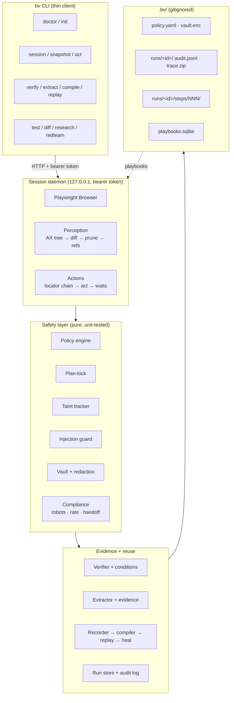

# browser-verified

**Explore once with an LLM, prove the result with evidence, compile it to a plain
Playwright script, replay it for free, and heal only the steps that break.**

`browser-verified` (CLI: `bv`) is an open-source browser-automation toolkit built
as an Agent Skill. It is designed for the case where an agent drives a real
browser and you need the result to be **provable**, **auditable** and
**reproducible** — not just a transcript that says it worked.

It is **not** a stealth tool. There is no fingerprint spoofing, no CAPTCHA
solving, no proxy rotation, no bot-detection evasion. The user agent is honest,
captcha and login walls trigger a human handoff, and `robots.txt` is respected.

---

## 60-second quickstart

```bash
npm install -g browser-verified     # or: npx browser-verified
bv doctor --install                 # check node + install the Chromium build
bv init                             # create .bv/ and a default policy
bv session start --headed           # a real, visible browser

# In another shell:
bv goto https://example.com
bv snapshot                          # compact, diffed accessibility tree
bv act click "Sign in"              # semantic target, resolved by a locator chain
bv verify --condition cond.json     # prove it with evidence

bv session stop
```

Mode A needs **no API key**: `bv` is a thin client that returns compact, diffed,
injection-scanned output, and records every command so the run can be compiled
afterwards.

---

## Why this exists

An agent that drives a browser has three problems, and this toolkit attacks all
three:

| Problem                  | What `bv` does                                                                                                                                                                                                   |
| ------------------------ | ---------------------------------------------------------------------------------------------------------------------------------------------------------------------------------------------------------------- |
| **Token cost**           | Returns a _diff_ of the accessibility tree, not the whole tree, and prunes decorative nodes. A 3-field form fill costs a fraction of a full snapshot.                                                            |
| **Unverifiable results** | Every run ends with a machine-checked **success condition** plus **evidence** (screenshot, snapshot, network facts). A run that does not verify is `unverified`, never "done".                                   |
| **Fragile scripts**      | The run is recorded as an intermediate representation and **compiled to a plain Playwright TypeScript script** with inferred assertions, which you can then replay for free and **heal** when a selector breaks. |

On top of that, the safety layer is the point, not a checkbox: prompt-injection
defenses, taint tracking, an approval gate, plan-lock, a secrets vault, network
dry-run and compliance rules are **built in**, not bolted on.

---

## Architecture



**Key idea:** every other command is a thin HTTP client to a detached daemon
that owns the browser. The daemon survives client crashes, so a sequence of CLI
calls shares one browser session.

---

## The two usage modes

**Mode A — host-driven (primary).** A host agent (Claude Code, Hermes, …) calls
`bv` commands itself. `bv` needs no LLM and no API key. Output is compact,
diffed and injection-scanned; every command is recorded so the run can be
compiled afterwards.

**Mode B — autonomous (optional).** `bv run --goal "..."` runs its own
planner → plan-lock → executor → verifier loop using the Anthropic API. The
verifier sees only the condition and fresh evidence, never the executor's
narrative. Requires `ANTHROPIC_API_KEY`; without it, Mode B exits with a clear
error and Mode A is unaffected.

---

## Security model

Read [`docs/SECURITY.md`](docs/SECURITY.md) for the full threat model. In
brief:

- **Policy engine** classifies every action (read / navigate / input / submit /
  destructive / financial / messaging / download / upload). Unknown means
  `needs_approval`, never `allow`.
- **Approval gate**: interactive TTY prompt or a single-use token bound to the
  exact action hash. Non-interactive default is deny.
- **Plan-lock**: any action outside the plan is denied with `off_plan`.
- **Taint tracking**: page-derived values are tainted; tainted input cannot
  reach cross-origin navigation, password/card/OTP fields, file paths, shell, or
  a message body without approval.
- **Injection guard**: page text is wrapped in a per-call nonce envelope;
  detectors flag hidden text, poisoned attributes, fake banners, exfil URLs and
  more. Severity `review` requires approval; `block` redacts.
- **Vault**: AES-256-GCM at rest, scrypt KDF. `{{secret:name}}` placeholders are
  resolved only inside the daemon and are masked in every artifact.

What it does **not** protect against is stated plainly in the same document —
the injection guard is heuristic, and time-travel cannot restore JS or server
state.

---

## Command surface

Every command supports `--help`, `--json` and a meaningful exit code.

| Exit code | Meaning             |
| --------- | ------------------- |
| 0         | ok                  |
| 1         | failure             |
| 2         | usage error         |
| 3         | policy denied       |
| 4         | needs approval      |
| 5         | injection block     |
| 6         | verification failed |

```text
bv doctor [--install]               bv test [--plan f|--auto]
bv init                              bv diff --a URL --b URL [--flow f]
bv session start|stop|status         bv research --questions q.json --sources urls.txt
bv plan set|show|amend              bv discover-api <runId>
bv snapshot [--full] [--max-tokens N] bv vault set|list|rm
bv act <kind> <target> [value]       bv memory ls|rm|prune
bv approve <actionId>                bv redteam run [--target guard|agent]
bv verify --condition cond.json      bv eval run [--tasks ...] [--arm bv|baseline]
bv extract --schema schema.json      bv report <runId> [--format html|md]
bv rewind --to N                     bv resume
bv compile <runId> --out f.spec.ts   bv mcp
bv replay <flow> [--var k=v] [--heal]
bv drift <flow>
```

---

## Repository layout

```text
browser-verified/
├── SKILL.md                 # the Agent Skill (<500 lines)
├── references/              # progressive disclosure docs
├── scripts/bv.mjs           # single-file bundled CLI
├── policies/default.yaml    # the shipped default policy
├── src/                     # TypeScript source
│   ├── cli/                 # commander wiring only
│   ├── core/                # daemon, client, contexts
│   ├── perception/          # snapshot, diff, prune, refs, tokens
│   ├── actions/             # locate, act, waits, download, frames
│   ├── safety/              # policy, approvals, planlock, taint, injection, vault
│   ├── verify/              # conditions, verifier, evidence, extract
│   ├── compile/             # recorder, compiler, replay, heal, drift
│   ├── interaction/         # typing, mouse, profiles, messy, throttle
│   ├── testing/             # runner, console, a11y, perf, visual, flake, diff
│   ├── research/            # workers, crosscheck, sources, apidiscovery
│   ├── llm/                 # client, anthropic, router, budget, cost
│   ├── memory/              # playbooks
│   └── report/              # html, md
├── fixtures/                # local test site (no network)
├── evals/                   # T01–T20 tasks, red-team pack, harness
├── test/                    # unit, integration, e2e
└── docs/                    # DECISIONS, KNOWN_LIMITATIONS, BENCHMARKS, …
```

---

## Development

```bash
npm install
npx playwright install chromium
npm run typecheck && npm run lint && npm test
npm run build          # bundles scripts/bv.mjs
```

Tests never touch the public internet; they run against the local fixture site
in `fixtures/`.

See [`docs/ARCHITECTURE.md`](docs/ARCHITECTURE.md) for the module map,
[`docs/DECISIONS.md`](docs/DECISIONS.md) for the design decisions and their
alternatives, and [`docs/KNOWN_LIMITATIONS.md`](docs/KNOWN_LIMITATIONS.md) for
what does not work.

---

## License

MIT — see [LICENSE](LICENSE).
