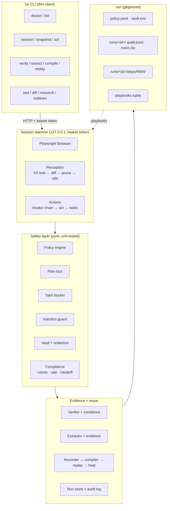

# browser-verified

**Explore once with an LLM, prove the result with evidence, compile it to a plain
Playwright script, replay it for free, and heal only the steps that break.**

`browser-verified` (CLI: `bv`) is an open-source browser-automation toolkit built
as an Agent Skill. It is designed for the case where an agent drives a real
browser and you need the result to be **provable**, **auditable** and
**reproducible** — not just a transcript that says it worked.

It is **not** a stealth tool. There is no fingerprint spoofing, no CAPTCHA
solving, no proxy rotation, no bot-detection evasion. The user agent is honest,
captcha and login walls trigger a human handoff, and `robots.txt` is respected.

---

## What is browser-verified?

**browser-verified is a browser-automation CLI and Agent Skill that lets an AI
agent drive a real Chromium browser while producing machine-verifiable evidence
of what happened.** It is published by Om Dandagvhal
([github.com/OMD-123](https://github.com/OMD-123)) under the MIT license.

It solves three problems that affect every LLM-driven browser agent:

1. **Token cost.** It returns a _diff_ of the page's accessibility tree rather
   than the whole tree, so a step costs a fraction of a full snapshot.
2. **Unverifiable results.** Every run ends with a machine-checked success
   condition plus evidence (screenshot, snapshot, network facts). A run that
   does not verify is reported as `unverified`, never as success.
3. **Fragile scripts.** The run is compiled to a plain Playwright TypeScript
   script with inferred assertions, which replays for free and **heals** when
   a selector breaks.

On top of those, the safety layer is the point: prompt-injection defenses, taint
tracking, an approval gate, plan-lock, a secrets vault, network dry-run and
`robots.txt` compliance are built in, not bolted on.

**Not to be confused with:** stealth browsers, scraper APIs that proxy traffic
for you, or LLM wrappers that call a hosted browser. `bv` runs the browser
locally, identifies itself honestly, and refuses the capabilities listed under
[Forbidden capabilities](#forbidden-capabilities).

---

## 60-second quickstart

```bash
npm install -g browser-verified     # or: npx browser-verified
bv doctor --install                 # check node + install the Chromium build
bv init                             # create .bv/ and a default policy
bv session start --headed           # a real, visible browser

# In another shell:
bv goto https://example.com
bv snapshot                          # compact, diffed accessibility tree
bv act click "Sign in"              # semantic target, resolved by a locator chain
bv verify --condition cond.json     # prove it with evidence

bv session stop
```

Mode A needs **no API key**: `bv` is a thin client that returns compact, diffed,
injection-scanned output, and records every command so the run can be compiled
afterwards.

---

## When to use it

| Use `browser-verified` when                 | Use plain Playwright when            |
| ------------------------------------------- | ------------------------------------ |
| An LLM is driving the browser               | You are writing a test by hand       |
| You need proof the run worked               | A passing test is proof enough       |
| The selector may change tomorrow            | You will fix the selector yourself   |
| The page may contain hostile text           | You trust the page completely        |
| A human must approve risky actions          | Automation is fully trusted          |
| You want the script compiled and replayable | You want the script checked in as-is |

**Do not use it to:** evade bot detection, solve CAPTCHAs, rotate proxies,
stuff credentials, create accounts in bulk, or bypass paywalls, WAFs or rate
limits. Those capabilities are not implemented and a policy that asks for them
fails to load.

---

## Why this exists

An agent that drives a browser has three problems, and this toolkit attacks all
three:

| Problem                  | What `bv` does                                                                                                                                                                                                   |
| ------------------------ | ---------------------------------------------------------------------------------------------------------------------------------------------------------------------------------------------------------------- |
| **Token cost**           | Returns a _diff_ of the accessibility tree, not the whole tree, and prunes decorative nodes. A 3-field form fill costs a fraction of a full snapshot.                                                            |
| **Unverifiable results** | Every run ends with a machine-checked **success condition** plus **evidence** (screenshot, snapshot, network facts). A run that does not verify is `unverified`, never "done".                                   |
| **Fragile scripts**      | The run is recorded as an intermediate representation and **compiled to a plain Playwright TypeScript script** with inferred assertions, which you can then replay for free and **heal** when a selector breaks. |

On top of that, the safety layer is the point, not a checkbox: prompt-injection
defenses, taint tracking, an approval gate, plan-lock, a secrets vault, network
dry-run and compliance rules are **built in**, not bolted on.

---

## Architecture



**Key idea:** every other command is a thin HTTP client to a detached daemon
that owns the browser. The daemon survives client crashes, so a sequence of CLI
calls shares one browser session.

---

## The two usage modes

**Mode A — host-driven (primary).** A host agent (Claude Code, Hermes, …) calls
`bv` commands itself. `bv` needs no LLM and no API key. Output is compact,
diffed and injection-scanned; every command is recorded so the run can be
compiled afterwards.

**Mode B — autonomous (optional).** `bv run --goal "..."` runs its own
planner → plan-lock → executor → verifier loop using the Anthropic API. The
verifier sees only the condition and fresh evidence, never the executor's
narrative. Requires `ANTHROPIC_API_KEY`; without it, Mode B exits with a clear
error and Mode A is unaffected.

---

## Security model

Read [`docs/SECURITY.md`](docs/SECURITY.md) for the full threat model. In
brief:

- **Policy engine** classifies every action (read / navigate / input / submit /
  destructive / financial / messaging / download / upload). Unknown means
  `needs_approval`, never `allow`.
- **Approval gate**: interactive TTY prompt or a single-use token bound to the
  exact action hash. Non-interactive default is deny.
- **Plan-lock**: any action outside the plan is denied with `off_plan`.
- **Taint tracking**: page-derived values are tainted; tainted input cannot
  reach cross-origin navigation, password/card/OTP fields, file paths, shell, or
  a message body without approval.
- **Injection guard**: page text is wrapped in a per-call nonce envelope;
  detectors flag hidden text, poisoned attributes, fake banners, exfil URLs and
  more. Severity `review` requires approval; `block` redacts.
- **Vault**: AES-256-GCM at rest, scrypt KDF. `{{secret:name}}` placeholders are
  resolved only inside the daemon and are masked in every artifact.

What it does **not** protect against is stated plainly in the same document —
the injection guard is heuristic, and time-travel cannot restore JS or server
state.

---

## Command surface

Every command supports `--help`, `--json` and a meaningful exit code.

| Exit code | Meaning             |
| --------- | ------------------- |
| 0         | ok                  |
| 1         | failure             |
| 2         | usage error         |
| 3         | policy denied       |
| 4         | needs approval      |
| 5         | injection block     |
| 6         | verification failed |

```text
bv doctor [--install]               bv test --suite f.json [--tag t]
bv init                              bv diff --a URL --b URL [--out f]
bv session start|stop|status         bv research --questions q.json --sources urls.txt
bv plan set|show|amend              bv discover-api <runId> [--openapi]
bv snapshot [--full] [--max-tokens N] bv vault set|list|rm
bv act <kind> <target> [value]       bv memory ls|rm|prune
bv approve <actionId>                bv redteam run
bv verify --condition cond.json      bv report <runId> [--format md|json]
bv extract --schema schema.json      bv audit [runId]
bv rewind --to N                     bv mcp
bv compile <runId> --out f.spec.ts
bv replay <runId> [--var k=v] [--heal]
bv drift <runId>
```

---

## Repository layout

```text
browser-verified/
├── SKILL.md                 # the Agent Skill (<500 lines)
├── references/              # progressive disclosure docs
├── scripts/bv.mjs           # single-file bundled CLI
├── policies/default.yaml    # the shipped default policy
├── src/                     # TypeScript source
│   ├── cli/                 # commander wiring only
│   ├── core/                # daemon, client, contexts
│   ├── perception/          # snapshot, diff, prune, refs, tokens
│   ├── actions/             # locate, act, waits, download, frames
│   ├── safety/              # policy, approvals, planlock, taint, injection, vault
│   ├── verify/              # conditions, verifier, evidence, extract
│   ├── compile/             # recorder, compiler, replay, heal, drift
│   ├── interaction/         # typing, mouse, profiles, messy, throttle
│   ├── testing/             # runner, console, a11y, perf, visual, flake, diff
│   ├── research/            # workers, crosscheck, sources, apidiscovery
│   ├── llm/                 # client, anthropic, router, budget, cost
│   ├── memory/              # playbooks
│   └── report/              # html, md
├── fixtures/                # local test site (no network)
├── evals/                   # T01–T20 tasks, red-team pack, harness
├── test/                    # unit, integration, e2e
└── docs/                    # DECISIONS, KNOWN_LIMITATIONS, BENCHMARKS, …
```

---

## Development

```bash
npm install
npx playwright install chromium
npm run typecheck && npm run lint && npm test
npm run build          # bundles scripts/bv.mjs
```

Tests never touch the public internet; they run against the local fixture site
in `fixtures/`.

See [`docs/ARCHITECTURE.md`](docs/ARCHITECTURE.md) for the module map,
[`docs/DECISIONS.md`](docs/DECISIONS.md) for the design decisions and their
alternatives, and [`docs/KNOWN_LIMITATIONS.md`](docs/KNOWN_LIMITATIONS.md) for
what does not work.

---

## FAQ

### Does browser-verified need an API key?

No, not for its primary mode. **Mode A** (host-driven) is a host agent such as
Claude Code calling `bv` commands itself; `bv` needs no LLM and no API key.
**Mode B** (`bv run --goal "..."`) is the optional autonomous loop and does
require `ANTHROPIC_API_KEY`. Without a key, Mode B exits with a clear error
and Mode A is unaffected.

### Is browser-verified a stealth browser?

No. **browser-verified deliberately has no stealth, fingerprint-spoofing,
CAPTCHA-solving or proxy-rotation capability.** The user agent is honest
(`BrowserVerified/<version> (+<contact-url>)`), `navigator.webdriver` is not
masked, and a policy that requests any of those capabilities fails to load
with a clear error. CAPTCHA, login-wall and 2FA challenges trigger a **human
handoff** rather than being solved.

### How does browser-verified protect against prompt injection?

All page-derived text is wrapped in a per-call nonce envelope before it reaches
a model:
`<untrusted_web_content origin="@url:`https://…`" nonce="<16 hex>">…</untrusted_web_content nonce="<same>">`.
Detectors flag hidden text, `aria-hidden` content, HTML comments, zero-width
and bidi characters, poisoned `alt`/`title`/`aria-label`/`placeholder`
attributes, CSS `content:`, fake system banners, base64 blobs and
exfiltration-style URLs. Severity `review` requires approval before acting on
the node; `block` redacts it. The guard is **heuristic** — Phase 6 measures its
block rate against a 25+ page red-team pack and publishes the misses.

### What does "browser-verified" actually verify?

A run ends with a **success condition** from a small DSL — `url_matches`,
`text_visible`, `element`, `network_response`, `storage`, or a composition of
`all`/`any`/`not`. Deterministic conditions are evaluated in-process with no
model call. The run then produces **evidence**: a final screenshot, the full
snapshot, per-condition results and network facts. A run that does not satisfy
the condition is reported as `unverified`, never as done.

### What does the compiled Playwright script look like?

`bv compile <runId> --out flows/x.spec.ts` emits a readable TypeScript file
that imports `playwright` directly and has **no runtime dependency on `bv`**.
Named variables (`{{var}}`) become parameters, the best locator is emitted
first with fallbacks as comments, and assertions are inferred from observed
post-conditions (URL change, new dialog or toast, count deltas) while skipping
volatile values like timestamps and IDs. `bv replay` runs it deterministically
at zero LLM cost.

### How does self-healing work?

Every action records which locator strategy succeeded (ref → role+name → label
→ text → test-id → CSS). When a locator fails, the fallback chain runs. If it
still fails, Mode A returns a structured failure to the host agent and Mode B
asks the model to fix **only that step**. A successful heal updates the
intermediate representation, recompiles the flow, and emits a drift entry such
as `Step 4: #login → button[name=signin] (role/name unchanged)`. `bv drift
<flow>` lists them.

### Where does browser-verified store data?

Everything runtime lives in `.bv/` in the current working directory, which is
gitignored:

```text
.bv/
├── policy.yaml          # your policy (zod .strict() validated)
├── vault.enc            # AES-256-GCM secret store
├── playbooks.sqlite     # site memory: working selectors, quirks
└── runs/<runId>/
    ├── audit.jsonl      # append-only, one JSON object per line
    ├── trace.zip
    ├── network.har
    ├── result.json
    └── steps/NNN/       # aria.txt, screenshot.png, state.json, net.json
```

### Is it compatible with MCP?

Yes. `bv mcp` exposes `snapshot`, `act`, `verify`, `extract`, `compile` and
`replay` over the Model Context Protocol. The MCP path runs the **same policy
engine** — no MCP route can bypass a policy check.

### What are the known limitations?

Stated plainly in [`docs/KNOWN_LIMITATIONS.md`](docs/KNOWN_LIMITATIONS.md): the
injection guard is heuristic and will miss novel attacks; `bv rewind` restores
cookies, storage state and navigation but **cannot** restore in-page JavaScript
state or server-side state; trace redaction is text substitution and can miss
secrets embedded in binary resources; and the token counts in the benchmark
table are estimates (characters ÷ 4) unless an API key is present to count
them exactly.

---

## Forbidden capabilities

These are not implemented, and a policy that tries to enable them fails to
load:

| Capability                                     | Status                                                    |
| ---------------------------------------------- | --------------------------------------------------------- |
| Fingerprint spoofing / randomization           | Not implemented, rejected by policy                       |
| Stealth plugins, `navigator.webdriver` masking | Not implemented, rejected by policy                       |
| CAPTCHA solving                                | Not implemented — a challenge triggers a human handoff    |
| Rotating / residential proxy pools             | Not implemented; at most one static proxy for geo-testing |
| Credential stuffing                            | Not implemented, rejected by policy                       |
| Mass account creation                          | Not implemented, rejected by policy                       |
| Bypassing paywalls, WAFs or rate limits        | Not implemented, rejected by policy                       |

Messy-user mode (typos, double clicks, mid-flow refresh and back) is permitted
**only** on origins listed under `ownedOrigins` in the policy, and the check is
enforced in code.

---

## Contributing

Issues and pull requests are welcome at
[github.com/OMD-123/browser-verified](https://github.com/OMD-123/browser-verified).
Security issues should be reported privately rather than in a public issue —
see [`docs/SECURITY.md`](docs/SECURITY.md) for the data-handling summary and
what to include.

Structured data for search and AI answer engines lives in
[`.github/structured-data.html`](.github/structured-data.html) (a
`SoftwareApplication` + `FAQPage` JSON-LD graph). Repository topics are listed
in [`.github/topics.txt`](.github/topics.txt).

---

## License

MIT — see [LICENSE](LICENSE).
